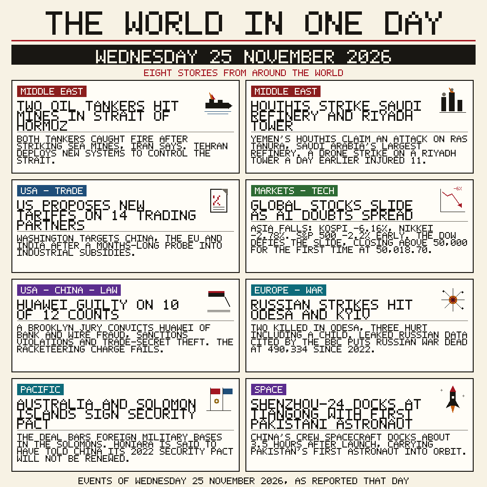

# The World in One Day — Wednesday 25 November 2026

[](https://make.fun/bounty/news-image-20261125)
[](https://make.fun/bounty/news-image-20261125)
[](https://make.fun/bounty/news-image-20261125)

A newspaper-style front page summing up the world's news of Wednesday 25 November 2026 in eight stories. `main.py` (Python 3.13 standard library only, no network) draws the 1024×1024 PNG deterministically — every pixel, including the bitmap font, is authored in this repository.



## The eight stories

1. **Middle East — Two oil tankers hit mines in the Strait of Hormuz.** Both tankers caught fire after striking sea mines, Iran says. Tehran deploys new systems to control the strait.
2. **Middle East — Houthis strike Saudi refinery and Riyadh tower.** Yemen's Houthis claim an attack on Ras Tanura, Saudi Arabia's largest refinery. A drone strike on a Riyadh tower a day earlier injured 11.
3. **USA / Trade — US proposes new tariffs on 14 trading partners.** Washington targets China, the EU and India after a months-long probe into industrial subsidies.
4. **Markets / Tech — Global stocks slide as AI doubts spread.** Asia falls: KOSPI −6.16%, Nikkei −2.78%. S&P 500 −2.2% early. The Dow defies the slide, closing above 50,000 for the first time at 50,018.70.
5. **USA / China / Law — Huawei guilty on 10 of 12 counts.** A Brooklyn jury convicts Huawei of bank and wire fraud, sanctions violations and trade-secret theft. The racketeering charge fails.
6. **Europe / War — Russian strikes hit Odesa and Kyiv.** Two killed in Odesa, three hurt including a child. Leaked Russian data cited by the BBC puts Russian war dead at 490,334 since 2022.
7. **Pacific — Australia and Solomon Islands sign security pact.** The deal bars foreign military bases in the Solomons. Honiara is said to have told China its 2022 security pact will not be renewed.
8. **Space — Shenzhou-24 docks at Tiangong with first Pakistani astronaut.** China's crew spacecraft docks about 3.5 hours after launch, carrying Pakistan's first astronaut into orbit.

## Run it

```sh
mkdir -p out && MAKEFUN_OUTPUT_DIR=out python3 main.py
```

Two runs write byte-identical `entry.png` (1024×1024, under 1 MiB).
